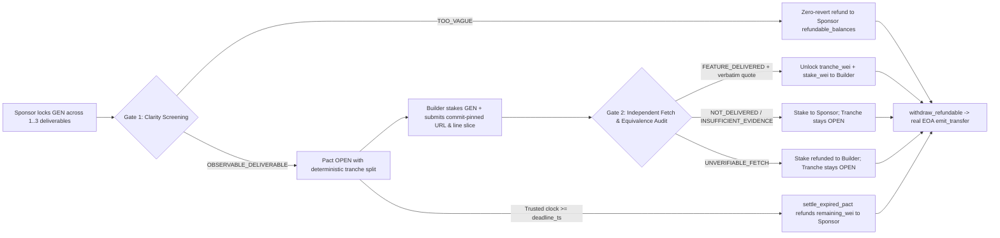

# Release Pact

**Multi-Tranche Open-Source Feature-Release Escrow & Deterministic Milestone Unlocker on GenLayer StudioNet.**

Sponsors lock GEN across `1..3` ordered feature deliverables bound to an external repository prefix (`allowed_source_prefix`). Builders submit commit-pinned release-note line slices (`raw.githubusercontent.com/<owner>/<repo>/<40-hex-sha>/<path>`) to unlock proportional tranches automatically under GenLayer Optimistic Democracy — while plain Python enforces strict escrow conservation, verbatim quote presence, retriable non-conclusive tranches, trusted-clock expiry settlement, and real EOA native transfers.

---

## Architecture



---

## Live GenLayer StudioNet Deployment (`Chain ID 61999`)

| Component | Address / Hash | Status |
| :--- | :--- | :--- |
| **`ReleasePact` Contract** | [`0x34e7311ab0AC6884f30EbA0D328Fe523B3C1a15a`](https://explorer-studio.genlayer.com/address/0x34e7311ab0AC6884f30EbA0D328Fe523B3C1a15a) | `FINALIZED` |
| **`EvidenceProbe` Contract** | [`0x16d0630E19DaCcA37E2d0056B74Dc15cB2aF1b66`](https://explorer-studio.genlayer.com/address/0x16d0630E19DaCcA37E2d0056B74Dc15cB2aF1b66) | `FINALIZED` |
| **Deploy `EvidenceProbe`** | [`0xdc13233a...91dc83ee`](https://explorer-studio.genlayer.com/tx/0xdc13233a56fa4f5a192f3695379a81d94a309e41531138ef72c8d47b91dc83ee) | `MAJORITY_AGREE / SUCCESS` |
| **Probe Flask 3.1.0 `L70..L95`** | [`0x2a48d80e...746b514f`](https://explorer-studio.genlayer.com/tx/0x2a48d80ea98c548a5c58b07d6a2a62e2031bafec1c11e01bbc7abb7a746b514f) | `MAJORITY_AGREE / SUCCESS` |
| **Deploy `ReleasePact`** | [`0xf90a68b8...bfa9a668`](https://explorer-studio.genlayer.com/tx/0xf90a68b8d73dd0236797b266a1b1a7cab04b829efb2e2d9d49d89386bfa9a668) | `MAJORITY_AGREE / SUCCESS` |
| **Create `pact-1` (2 tranches, 200 wei)** | [`0x7f927dff...f25d8b25`](https://explorer-studio.genlayer.com/tx/0x7f927dff4aebe48d2f9aa06ebe833ec53bb9d80dc3549099b98b0c01f25d8b25) | `OBSERVABLE_DELIVERABLE` |
| **`audit-1` (`pact-1` T0 `SECRET_KEY_FALLBACKS`)** | [`0xc5d6c320...b6edf904`](https://explorer-studio.genlayer.com/tx/0xc5d6c32093305b119d8f4f114ddb5357ae7063197edcecbf2de72274b6edf904) | `FEATURE_DELIVERED` (+120 wei) |
| **`audit-2` (`pact-1` T1 Flask 3.1.2)** | [`0x8893f810...ffc11c66`](https://explorer-studio.genlayer.com/tx/0x8893f8104e6f5c3b232515000175c0f606e76e2853639b1b26f5e49fffc11c66) | `NOT_DELIVERED` (T1 stays `OPEN`) |
| **`audit-3` (`pact-1` T1 retry Flask 3.1.0)** | [`0x73f37499...6dc36455`](https://explorer-studio.genlayer.com/tx/0x73f37499cf2e1055ec8b3621faa1fce0c5c785b3e42ecb11ce9c1d166dc36455) | `FEATURE_DELIVERED` (`FULLY_DELIVERED`) |
| **Create `pact-2` (subjective UX)** | [`0x575981ce...f1f1781f3`](https://explorer-studio.genlayer.com/tx/0x575981ce1c177e210f98d5bf304b61ed8f2a24f085b1e806d0cd896f1f1781f3) | `TOO_VAGUE` (100 wei refunded) |
| **Create `pact-3` (Flask 3.2.0 `app.query`)** | [`0x883a3df2...f0325230`](https://explorer-studio.genlayer.com/tx/0x883a3df22e6d2fa3de3f9c2702895de33d52f185a927996dbf440255f0325230) | `OBSERVABLE_DELIVERABLE` |
| **`audit-4` (`pact-3` empty slice `L9000..L9020`)** | [`0x5fc12204...b3ea1358`](https://explorer-studio.genlayer.com/tx/0x5fc1220441c0ae7f78328d28deaa44e1eed22f16bb77dce046bd8f03b3ea1358) | `UNVERIFIABLE_FETCH` (stake refunded) |
| **`audit-5` (`pact-3` `protectai/rebuff` injection)** | [`0xe5442016...bebe165d`](https://explorer-studio.genlayer.com/tx/0xe544201672c5bfb499c4eac392741f4ffb51ba3bef296f1a0e9bd488bebe165d) | `INSUFFICIENT_EVIDENCE` (injection ignored) |
| **`audit-6` (`pact-3` forbidden author URL)** | [`0xf6c8d65d...393b9831d`](https://explorer-studio.genlayer.com/tx/0xf6c8d65d65af59f7007e1df777f8d32cb74cb5673ac7f7991c4ba40393b9831d) | `REJECTED_INVALID` (stake refunded) |
| **Create `pact-4` (`timeout_seconds=15`)** | [`0xc88af1fe...c89ea5e4`](https://explorer-studio.genlayer.com/tx/0xc88af1fea66554454aa0ba0af9293627f1f2f62144a730fe19e40c5dc89ea5e4) | `OBSERVABLE_DELIVERABLE` |
| **Settle Expired `pact-4`** | [`0xee76235d...57332949`](https://explorer-studio.genlayer.com/tx/0xee76235dc41f99850ed8cb50c0a0da27cd093ec2a52c4f4ba392f78357332949) | `EXPIRED_SETTLED` (100 wei refunded) |
| **Sponsor EOA `withdraw_refundable()`** | [`0x75aa4cfb...3664e92`](https://explorer-studio.genlayer.com/tx/0x75aa4cfbfce232721e54a4aaadc8e782f0c1f4dc87cca8ce3eb9d36063664e92) | EOA `0 -> 240 wei` |
| **Builder EOA `withdraw_refundable()`** | [`0xd10f2660...11d1535`](https://explorer-studio.genlayer.com/tx/0xd10f2660dc384ff16343f723f3fd4670d4adc5d077e55d6fc564595cf11d1535) | EOA `0 -> 280 wei` |

---

## Quick Start

```bash
# 1. Run contract unit tests
python -m pytest tests/test_release_pact.py -v

# 2. Independently verify all 16 StudioNet txs & live contract state
python deploy/verify_proof.py

# 3. Run the Swiss Release Engineering Ledger web app
cd frontend && npm install && npm run test && npm run dev
```

See [docs/TUTORIAL.md](docs/TUTORIAL.md) for the complete architecture walkthrough and [docs/DEMO_SCRIPT.md](docs/DEMO_SCRIPT.md) for the 90-second demo path.
