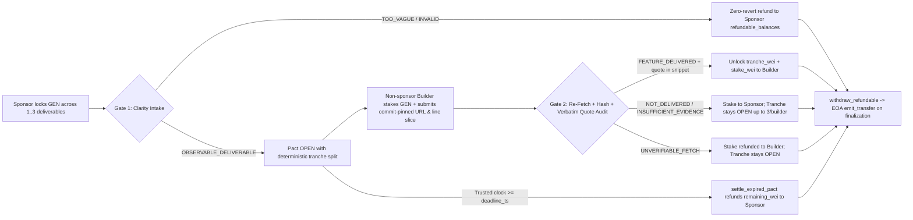

# Release Pact

**Multi-Tranche Open-Source Feature-Release Escrow & Deterministic Milestone Unlocker on GenLayer StudioNet.**

Sponsors lock GEN across `1..3` ordered feature deliverables bound to a repository-scoped canonical prefix (`https://raw.githubusercontent.com/<owner>/<repo>/`) and an optional `min_release_date` (`YYYY-MM-DD`). Non-sponsor builders submit commit-pinned release-note line slices to unlock proportional tranches automatically under GenLayer Optimistic Democracy — while deterministic Python enforces escrow conservation, verbatim quote presence inside the fetched snippet, per-builder attempt caps, trusted-clock expiry settlement, and chain-layer EOA transfers executed strictly upon finalization.

---

## Architecture



---

## Live GenLayer StudioNet Deployment (`Chain ID 61999`, v1.1)

| Component | Address / Hash | Outcome |
| :--- | :--- | :--- |
| **`ReleasePact` Contract** | [`0x2bc81019DF2A0Ef3d238AC9ae9679059c90d20C0`](https://explorer-studio.genlayer.com/address/0x2bc81019DF2A0Ef3d238AC9ae9679059c90d20C0) | `FINALIZED` |
| **`EvidenceProbe` Contract** | [`0x3261f64fd4EAf570cB9AAb559a28A6F8BF27084B`](https://explorer-studio.genlayer.com/address/0x3261f64fd4EAf570cB9AAb559a28A6F8BF27084B) | `FINALIZED` |
| **Deploy `EvidenceProbe`** | [`0x38cb7aef...9d5c8736`](https://explorer-studio.genlayer.com/tx/0x38cb7aef3d4558e9c6fea9b9eda793262e7d38645ff0312aa3aaa67a9d5c8736) | `MAJORITY_AGREE / SUCCESS` |
| **Probe Flask 3.1.0 `L70..L95`** | [`0x307b18b6...800716cd`](https://explorer-studio.genlayer.com/tx/0x307b18b6683b1fc91bb1721e2ba2b51cfd5bd3c7cfea1496944f227d800716cd) | `MAJORITY_AGREE / SUCCESS` |
| **Deploy `ReleasePact`** | [`0x07fc577b...086c77597`](https://explorer-studio.genlayer.com/tx/0x07fc577bd8da3f88c8263e02b4daf74f58d129d028cbd9bb49fb16a086c77597) | `MAJORITY_AGREE / SUCCESS` |
| **Create `pact-1` (2 tranches, `min_release_date=2024-11-01`, 200 wei)** | [`0xaff4b00e...69c48ed4`](https://explorer-studio.genlayer.com/tx/0xaff4b00e1a592b168232c5dc9e7e9700c317e1bd7410aa32bbd8388469c48ed4) | `OBSERVABLE_DELIVERABLE` |
| **`audit-1` (`pact-1` T0 `SECRET_KEY_FALLBACKS`)** | [`0xcc5f33f4...2d4342655`](https://explorer-studio.genlayer.com/tx/0xcc5f33f4580aa677bdbf3391416e09da85da616e06364e9511763332d4342655) | `FEATURE_DELIVERED` (+120 wei) |
| **`audit-2` (`pact-1` T1 Flask 3.1.2)** | [`0xf6d4e023...784bf6f2`](https://explorer-studio.genlayer.com/tx/0xf6d4e023db9720b8c8ed34c32db357cfa8b0e013badcda740333203a784bf6f2) | `NOT_DELIVERED` (T1 stays `OPEN`) |
| **`audit-3` (`pact-1` T1 retry Flask 3.1.0)** | [`0x1330f0fd...ce542275c`](https://explorer-studio.genlayer.com/tx/0x1330f0fdca0e30d557535d216b150f567db3c1cfe589559805ba20fce542275c) | `FEATURE_DELIVERED` (`FULLY_DELIVERED`) |
| **Create `pact-2` (subjective UX)** | [`0xf3c88ee8...818e16a4`](https://explorer-studio.genlayer.com/tx/0xf3c88ee82ffab44b7ef9980ad388f5835e746b85c499161ee8e18202818e16a4) | `TOO_VAGUE` (100 wei refunded) |
| **Create `pact-3` (Flask 3.2.0, strict `pallets/flask/` prefix)** | [`0xf801c4dc...200e1441`](https://explorer-studio.genlayer.com/tx/0xf801c4dcc1def4574acd9b0629e8c998081f183204517299b35f9506200e1441) | `OBSERVABLE_DELIVERABLE` |
| **`audit-4` (`pact-3` empty slice `L9000..L9020`)** | [`0xaa5e7350...83d3e35ee`](https://explorer-studio.genlayer.com/tx/0xaa5e7350311f01dc69ddc694aa465058f7a94997f3a87d2302f33b983d3e35ee) | `UNVERIFIABLE_FETCH` (stake refunded) |
| **`audit-5` (`pact-3` cross-repo URL blocked)** | [`0x1c33b6c4...034a8a4bd`](https://explorer-studio.genlayer.com/tx/0x1c33b6c4fc4b7924efc1ca63768760451cf3779e1c7905c59879526034a8a4bd) | `REJECTED_INVALID: URL_OUTSIDE_ALLOWED_PREFIX` |
| **`audit-6` (`pact-3` Sponsor self-submission blocked)** | [`0xf922bed1...7ee4e53e3`](https://explorer-studio.genlayer.com/tx/0xf922bed1cc24ba05bab66ca77ef6ecf46d15099046d9dbe690691677ee4e53e3) | `REJECTED_INVALID: SPONSOR_CANNOT_SUBMIT_PROOF` |
| **Create `pact-4` (`ProtectAI Rebuff SDK`)** | [`0x9c3a3e89...7d5c17642`](https://explorer-studio.genlayer.com/tx/0x9c3a3e89fde0daf4e5aa9687e7b329ba2a35099dac245520618360f7d5c17642) | `OBSERVABLE_DELIVERABLE` |
| **`audit-7` (`pact-4` `protectai/rebuff` injection)** | [`0x72dc015c...f319ab23`](https://explorer-studio.genlayer.com/tx/0x72dc015c603527e6f8b94406b7ebf68f289573a6523ed2864c4dda03f319ab23) | `INSUFFICIENT_EVIDENCE` (injection ignored) |
| **Create `pact-5` (`timeout_seconds=15`)** | [`0x6ae36c8e...f6e2709b`](https://explorer-studio.genlayer.com/tx/0x6ae36c8efeec3b33df94e6e7e8e28e44bc9264451f9659db48e8571af6e2709b) | `OBSERVABLE_DELIVERABLE` |
| **Settle Expired `pact-5`** | [`0x1c78067b...dfd699994`](https://explorer-studio.genlayer.com/tx/0x1c78067bb8dbedeba6712fe7dd72ad264982bffed182df6887d156edfd699994) | `EXPIRED_SETTLED` (100 wei refunded) |
| **Sponsor EOA `withdraw_refundable()`** | [`0x113c09e4...86b3fb8ef`](https://explorer-studio.genlayer.com/tx/0x113c09e43f21736ac6230ea080fd0ce7c66e313e7079f39ae86a30186b3fb8ef) | EOA `0 -> 260 wei` (on finalization) |
| **Builder EOA `withdraw_refundable()`** | [`0xca6dbf33...f3e0a224c`](https://explorer-studio.genlayer.com/tx/0xca6dbf3393f72b8e463721f20dfa6d6145e9ce002ba840b2d445344f3e0a224c) | EOA `0 -> 280 wei` (on finalization) |

---

## Quick Start

```bash
# 1. Run Python contract unit tests (6 tests)
python -m pytest tests/test_release_pact.py -v

# 2. Independently verify all 18 StudioNet txs & 13 live contract invariants
npm run verify:proof

# 3. Run frontend Vitest suite, typecheck, and dev server
cd frontend && npm install
cd .. && npm run test && npm run lint && npm run dev
```

---

## Honest Limitations & Security Notes

- **Changelog-Date vs. GitHub Release API `created_at`:** `ReleasePact` validates `min_release_date` (`YYYY-MM-DD`) against the release-note text inside the pinned commit file rather than querying the rate-limited unauthenticated GitHub Releases API (60 req/hr per IP). Because raw file text is authored by the repository's maintainers, sponsors should bind `allowed_source_prefix` only to trusted upstream repositories (`<owner>/<repo>/`).
- **Historical Demo Fixtures:** `pact-1` uses real historical Pallets Flask 3.1.0 / 3.1.2 release notes (`2024-11-13` / `2025-08-19`) with `min_release_date="2024-11-01"` so all positive and negative paths finalize immediately without waiting for future upstream releases.
- **Browser MetaMask Write Execution:** All 18 write transactions in [`deploy/proof.json`](deploy/proof.json) were executed live on StudioNet using `genlayer-py` (`0.18.0`) EOA accounts. The frontend [`02 · Pact Desk`](frontend/src/components/PactDesk.tsx) initializes `client.initializeConsensusSmartContract()` prior to `writeContract` and is ready for MetaMask on Chain `61999`, while live read parity (`Verify Live RPC`) and WebCrypto SHA-256 verification (`Verify SHA-256 in Browser`) were verified directly in Chromium without a wallet.
- **Per-Tranche Attempt Bounds:** Each builder is capped at `3` Gate-2 attempts per tranche (`15` total across distinct builders) and sponsors cannot self-submit proofs (`SPONSOR_CANNOT_SUBMIT_PROOF`). In production with larger bounties, `min_stake_wei` should be raised proportionally to deter multi-account Sybil spam.

See [docs/TUTORIAL.md](docs/TUTORIAL.md) for the code-level walkthrough and [docs/DEMO_SCRIPT.md](docs/DEMO_SCRIPT.md) for the two-minute reviewer script.
