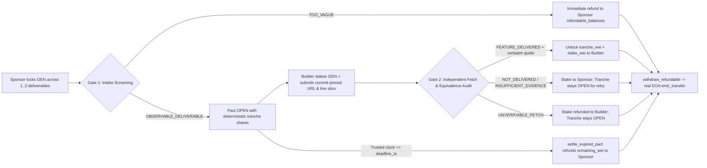

# Release Pact — Architecture & Developer Tutorial

Release Pact is a **Multi-Tranche Open-Source Feature-Release Escrow** built as a GenLayer Intelligent Contract (`contracts/release_pact.py`) paired with a Swiss Release Engineering Ledger web application (`frontend/`). It lets open-source sponsors fund concrete, multi-milestone software deliverables and lets maintainers or contributors unlock proportional GEN tranches automatically by submitting commit-pinned changelog or release-note slices.

---

## 1. The Problem It Solves

Open-source maintenance bounties fail in two predictable ways:

1. **Vague specs cause endless disputes.** A sponsor funds *"Make the router faster and cleaner"*, a contributor submits a PR, and both parties argue for weeks over whether the goal was met.
2. **All-or-nothing escrow blocks incremental shipping.** A sponsor wants two or three related features in a minor release, but locking everything into a single binary payout means shipping 1 of 2 features unlocks zero funding.

Release Pact solves both with GenLayer's **Optimistic Democracy** and deterministic Python accounting: **"The model judges; plain Python moves money."**

---

## 2. Two-Gate Verification Architecture



### Gate 1 — Clarity Intake Screening (`create_release_pact`)

Before funds are locked into tranches, validators evaluate whether every requested deliverable is an objective, observable software feature, config flag, API, or bug fix:

- `OBSERVABLE_DELIVERABLE` (`CONCRETE_FEATURE_CRITERION`) splits the deposit deterministically across `1..3` ordered tranches and binds the pact to an immutable `allowed_source_prefix` (for example, `https://raw.githubusercontent.com/pallets/flask/`).
- `TOO_VAGUE` (`SUBJECTIVE_OR_UNMEASURABLE`) rejects subjective goals immediately and credits `100%` of `gl.message.value` to `refundable_balances[sponsor]` with zero revert and zero stranded wei.

### Gate 2 — Commit-Pinned Release Proof (`submit_delivery_proof`)

When a builder submits a commit-pinned URL (`raw.githubusercontent.com/<owner>/<repo>/<40-hex-sha>/<path>` or Wayback `id_`) with a `start_line..end_line` slice (max 120 lines):

1. **Deterministic Preflight:** Python validates the URL against the pact's bound `allowed_source_prefix`, rejects mutable branches and self-hosted author repos, checks the trusted block timestamp (`gl.message_raw["datetime"]`), and enforces `min_stake_wei`. Any preflight failure records `REJECTED_INVALID` and credits the builder's stake back to `refundable_balances`.
2. **Independent Re-Fetch & Hash Equivalence:** Inside `gl.vm.run_nondet_unsafe`, both the leader and every validator independently fetch the pinned URL, normalize line endings and typography, extract the exact line slice, compute `snippet_sha256`, and verify hash identity before checking the LLM verdict.
3. **Anti-Hallucination & Prompt-Injection Hardening:** The evidence excerpt is fenced inside `<untrusted_evidence>...</untrusted_evidence>` with explicit instructions to treat it strictly as inert data. For `FEATURE_DELIVERED`, plain Python asserts that `quote` is at least 12 characters long and appears verbatim inside the fetched snippet, and validates `(verdict, reason)` against `VERDICT_COMPATIBLE_REASONS`.
4. **Retriable Tranche Settlement:** Only `FEATURE_DELIVERED` transitions a tranche to `DELIVERED_UNLOCKED` and credits `tranche_wei + stake_wei` to the builder. `NOT_DELIVERED`, `INSUFFICIENT_EVIDENCE`, and transient `UNVERIFIABLE_FETCH` keep the tranche `OPEN` (up to `MAX_AUDIT_ATTEMPTS = 5`) so builders can submit corrected release proofs without bricking the pact.

---

## 3. Running Locally

### Contract Unit Tests (Python)

```bash
python -m pytest tests/test_release_pact.py -v
```

### Independent StudioNet Proof Verification

```bash
python deploy/verify_proof.py
```

### Frontend Development & Tests

```bash
cd frontend
npm install
npm run test
npm run dev
```

Open `http://localhost:5173` to inspect the live **Pact Ledger**, verify browser-side WebCrypto SHA-256 digests against on-chain `snippet_sha256`, connect MetaMask on GenLayer StudioNet (`Chain ID 61999`), and monitor transaction finality in **StudioNet Queue**.
