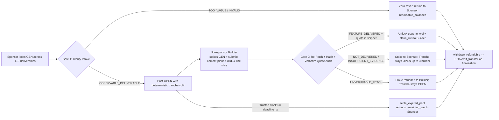

# Release Pact — Architecture & Developer Tutorial

Release Pact is a **Multi-Tranche Open-Source Feature-Release Escrow** built on **GenLayer StudioNet** (`Chain ID 61999`). Sponsors lock GEN across `1..3` ordered feature deliverables bound to a canonical external repository prefix (`https://raw.githubusercontent.com/<owner>/<repo>/`) and an optional `min_release_date` (`YYYY-MM-DD`). Builders submit commit-pinned release-note line slices to unlock proportional GEN tranches under GenLayer Optimistic Democracy, while deterministic Python handles every wei transfer, attempt cap, expiry fallback, and finalization-gated EOA payout.

---

## 1. Two-Gate Verification Architecture



---

## 2. Enforcing Repository Scope & Anti-Griefing in Python

In [`contracts/release_pact.py`](../contracts/release_pact.py), every pact is bound to a repository-scoped upstream prefix so no builder can substitute an unrelated repository or mutable branch (`main`/`master`). Wildcard host prefixes like `https://raw.githubusercontent.com/` are rejected deterministically before consensus:

```python
def _validate_source_prefix(prefix: str) -> str:
    clean = prefix.strip()
    parsed = urlparse(clean)
    if parsed.scheme != "https" or parsed.netloc.lower() not in ALLOWED_EVIDENCE_HOSTS:
        return "INVALID_SOURCE_PREFIX"
    if parsed.netloc.lower() == "raw.githubusercontent.com":
        parts = [p for p in (parsed.path or "").split("/") if p]
        if len(parts) < 2 or not clean.endswith("/"):
            return "UNSCOPED_GITHUB_PREFIX"
    return ""
```

To prevent a malicious sponsor from self-submitting bogus proofs to freeze a tranche before `deadline_ts`, `submit_delivery_proof` blocks `builder == pact["sponsor"]` (`SPONSOR_CANNOT_SUBMIT_PROOF`) and enforces per-builder attempt limits (`MAX_ATTEMPTS_PER_BUILDER = 3`, `MAX_TOTAL_AUDITS_PER_TRANCHE = 15`) with immediate stake refunds on invalid preflights:

```python
if builder == str(pact.get("sponsor", "")):
    rejection_reason = "SPONSOR_CANNOT_SUBMIT_PROOF"
elif builder_prior_attempts >= MAX_ATTEMPTS_PER_BUILDER:
    rejection_reason = "BUILDER_ATTEMPT_LIMIT_REACHED"
```

---

## 3. Evidence-Hash & Verbatim-Quote Equivalence (`gl.vm.run_nondet_unsafe`)

Inside Gate 2, the leader and every validator independently fetch the commit-pinned URL, normalize typography and line endings, slice `start_line..end_line`, and compute `snippet_sha256`. Validators reject the leader unless:
1. Both fetched identical bytes (`l_obj["snippet_sha256"] == snippet_sha256`).
2. Every `(verdict, reason)` pair is in `VERDICT_COMPATIBLE_REASONS`.
3. Any `FEATURE_DELIVERED` verdict carries a verbatim `quote` (`>= 12` chars) that exists inside the validator's own fetched `snippet`, and the stored preview window centers around that quote (`_excerpt_around_quote`).

```python
l_quote = _normalize_text(str(l_obj.get("quote", "")).strip())
if l_verdict == "FEATURE_DELIVERED":
    if len(l_quote) < MIN_QUOTE_CHARS or l_quote not in snippet:
        return False

expected_excerpt = _excerpt_around_quote(snippet, l_quote, MAX_EXCERPT_STORED)
if str(l_obj.get("snippet_excerpt", "")) != expected_excerpt:
    return False
```

---

## 4. Finalization-Gated Native EOA Transfers & Wallet Integration

Chain-layer EOA payouts use GenLayer's `@gl.evm.contract_interface` `emit_transfer`, which executes strictly upon GenLayer finalization (after the native Appeal Window):

```python
@gl.evm.contract_interface
class _EoaRecipient:
    class View:
        pass
    class Write:
        pass

# Inside withdraw_refundable():
self.refundable_balances[sender] = u256(0)
_EoaRecipient(gl.message.sender_address).emit_transfer(value=u256(amount))
```

In the frontend ([`frontend/src/lib/studionet.ts`](../frontend/src/lib/studionet.ts)), `writeStudioNetContract` always awaits `client.initializeConsensusSmartContract()` before dispatching a wallet write so `consensusMainContract` is guaranteed initialized on cold page loads:

```ts
const client = createClient({
  chain: studionet,
  endpoint: STUDIONET_RPC_URL,
  account: params.account as `0x${string}`,
  provider: eth as never,
});
await client.initializeConsensusSmartContract();
return String(await client.writeContract({ address, functionName, args, value }));
```

---

## 5. Running & Verifying Locally

```bash
# 1. Run all Python contract unit tests
python -m pytest tests/test_release_pact.py -v

# 2. Independently verify every StudioNet transaction & live contract invariant
npm run verify:proof

# 3. Run frontend unit tests, typecheck, and dev server
npm run test && npm run lint && npm run dev
```

Open `http://localhost:5173`, click **`Verify Live RPC`** in the top bar to switch from the recorded proof manifest to live StudioNet RPC state, and click **`Verify SHA-256 in Browser`** on `audit-1` or `audit-3` to independently recompute WebCrypto SHA-256 parity with on-chain `snippet_sha256`.
